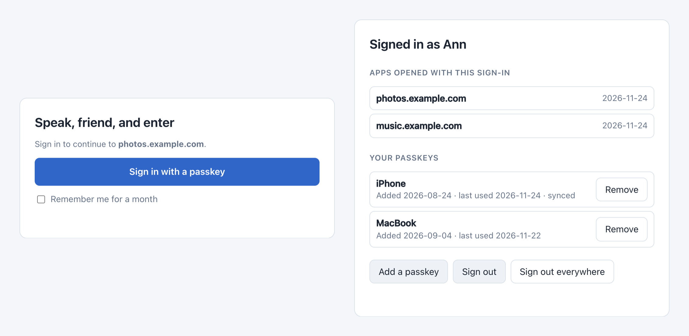
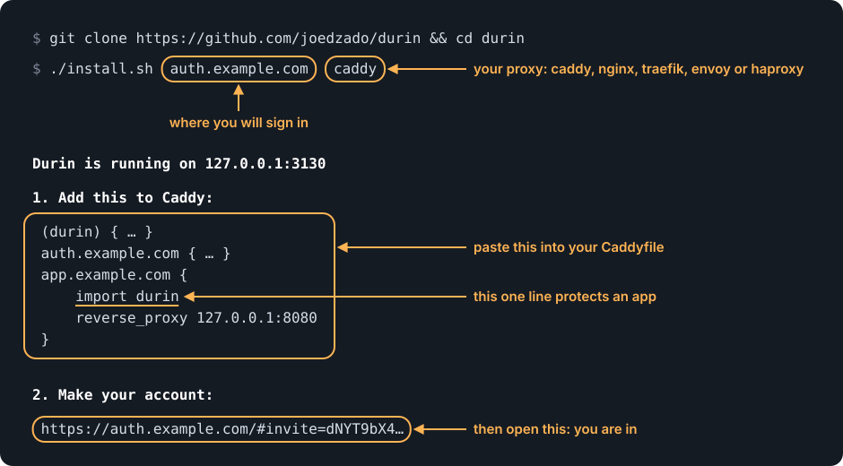

# Durin

One passkey sign-in for all your self-hosted apps.

Durin sits behind your reverse proxy. Sign in once at `auth.example.com` and every app on `*.example.com` opens. No passwords, no email, no outside service.

<picture>
  <source media="(prefers-color-scheme: dark)" srcset="docs/img/dark.png">
  
</picture>

## Install

```sh
git clone https://github.com/joedzado/durin && cd durin
./install.sh auth.example.com caddy
```



The first run also installs [Revet](https://github.com/joedzado/revet), the C++ framework Durin is written in.

## Use

- **Protect an app:** add the app rule that `install.sh` printed. With Caddy that is one line, `import durin`.
- **Invite someone:** sign in at `auth.example.com` and press *New invite link*. There is no other way to get an account.
- **Know who it is:** your app gets the account name in the `Remote-User` header.
- **Sign out:** once, everywhere.
- **Update:** `git pull && ./install.sh`
- **Lost your passkey, or want a second owner:** run `./durin owner` on the server for a new owner link.

Everyone with an account can open every app; Durin has no per-app permissions and is not an OIDC provider. Pick the sign-in name carefully: passkeys belong to it and do not survive a rename.

## Settings

None are needed. To change one, add it to `.env.local` and run `./install.sh`.

| Setting | Default | |
|---|---|---|
| `DURIN_IDLE_SECONDS` | `300` | Sign out after this long without activity |
| `DURIN_MAX_SECONDS` | `43200` | Sign out after this long regardless |
| `DURIN_REMEMBER_SECONDS` | `2592000` | How long "Remember me" lasts |
| `DURIN_USER_HEADER` | `Remote-User` | Header with the account name |
| `DURIN_PORT` | `3130` | Local port |

## More

- [Proxy recipes](docs/proxies.md), including private names such as `*.home`
- [Security](SECURITY.md): how it works, what it protects against, what it does not. Not independently audited.

MIT license.
